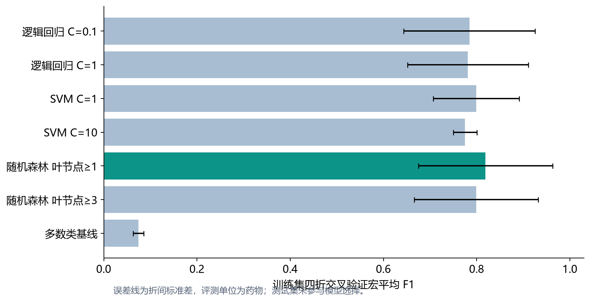

# 利用细胞形态预测药物作用机制

生物医学信息学课程设计，第十六题。基于 Broad Institute LINCS Cell Painting 公开数据，完成 Problem → Data → Model → Benchmark → Biological interpretation。

本仓库包含可复现实验和交互演示；个人课程报告与讲稿另行提交。

## 研究任务与结果

输入药物处理后已经提取的 CellProfiler 形态特征，预测五种已知作用机制：EGFR、HDAC、MEK、拓扑异构酶及微管聚合抑制剂。使用 A549、48 小时、同一实验批次的中位数共识特征；没有重新拍摄或分析原始显微图像。

64 种药物，每药三个剂量编码，共 192 行。按药物分层留出 16 种测试药物，其余 48 种进行四折交叉验证。同药全部剂量在同一组，能匹配到相同 InChIKey 前 14 位结构的记录同组。6 种药物缺少结构映射，保留 Broad ID。药物标识、名称、机制等不进入模型。

每个训练折内依次执行中位数填补、常量过滤、标准化、ANOVA 筛选 100 个特征。比较逻辑回归、RBF SVM、随机森林与多数类基线；药物级预测为三个剂量类别概率的算术平均。训练前方案见 [EXPERIMENT_PROTOCOL.md](EXPERIMENT_PROTOCOL.md)。

| 结果 | 数值 |
|---|---:|
| 最终随机森林训练 CV 药物级宏 F1 | 0.819 ± 0.144（折间标准差） |
| 留出药物分类正确数 | 16/16 |
| 药物级准确率 Wilson 95% 区间 | 80.6%–100% |
| 逐剂量正确数 | 45/48（93.75%） |
| 逐剂量宏 F1 | 0.936 |
| 多数类基线测试药物级宏 F1 | 0.080 |
| 逻辑回归 30 次药物标签置换 p | 0.0323（加一校正） |



结果只支持当前五类小规模子集内的概念验证。测试药物少、单细胞系和单批次，不能声称普遍 100% 准确。所有药物均正确导致经验 bootstrap 区间退化为 [1,1]，因此正文报告 Wilson 区间并保留退化说明。当前没有化学骨架外推、外部批次或未知机制识别验证。

形态解释指向核区域 DNA 颗粒度、形状和纹理等统计关联。随机森林不纯度重要性按区域汇总：核 51.9%、整细胞 36.7%、细胞质 11.4%；不等于因果贡献或直接分子靶点。补充逻辑回归解释模型的系数单独保存。核掩膜中的 Mito 通道不意味着线粒体位于细胞核。

## 查看结果

直接打开 `demo/index.html` 可离线查看已保存案例与图表。实时 CSV 预测需先按下方步骤生成模型并启动服务，示例输入为 `data/processed/example_input.csv`。

## 换电脑或从 GitHub 复现

推荐 Python 3.12。Windows PowerShell 在项目根目录运行：

```powershell
py -3.12 -m venv .venv
.venv\Scripts\python.exe -m pip install -r requirements.txt
.venv\Scripts\python.exe src/download_data.py
.venv\Scripts\python.exe src/run_experiment.py
.venv\Scripts\python.exe src/analyze_results.py
.venv\Scripts\python.exe src/build_demo.py
.venv\Scripts\python.exe src/verify_project.py
.venv\Scripts\python.exe src/serve_demo.py
```

首次下载需要联网，原始形态文件约 59 MB；数据和依赖就绪后训练、预测和演示均可离线。本机已有依赖与模型，可用 `一键复现实验.cmd` 重算（会覆盖当前结果与模型），用 `一键检查项目.cmd` 仅验证。

固定源版本、随机种子和包版本可复现主要结果；不同平台和依赖版本可能出现微小数值差异。版本见 `results/summary.json`，下载地址和 SHA-256 见 `data/source_manifest.json`。模型保存的训练组仅 48 种药物，没有用测试药物重新拟合。

GitHub 源码包不包含原始大文件、本机依赖、模型和个人汇报材料，需按上述步骤生成模型；本地完整文件夹已包含这些成果。报告生成脚本另需 `python-docx`，演示 PPT 使用 JavaScript artifact-tool 构建，Office 用于 PDF 导出；科研实验运行不依赖 Office 或 artifact-tool。

## 文件索引

| 路径 | 用途 |
|---|---|
| `config.json` / `EXPERIMENT_PROTOCOL.md` | 预设研究范围与参数 |
| `src/download_data.py` | 固定版本数据下载与哈希校验 |
| `src/run_experiment.py` | 完整训练、测试、置换及消融 |
| `src/analyze_results.py` | 独立性审计、区间和图表 |
| `src/predict.py` | 加载真实模型的 CSV 推理 |
| `src/serve_demo.py` | 仅监听本机的演示服务 |
| `src/verify_project.py` | 实际模型与保存概率一致性验证 |
| `data/processed/sample_metadata.csv` | 固定训练/测试划分 |
| `results/cv_summary.csv` | 全部七组预设模型结果 |
| `results/test_*predictions.csv` | 逐药物和逐剂量真实输出 |
| `results/test_error_cases.csv` | 三个错误案例 |
| `results/verification.json` | 保存模型复核结果 |
| `references/` | 来源、上游许可与处理说明 |

## 数据、引用与许可

数据来自 [Broad Institute LINCS Cell Painting](https://github.com/broadinstitute/lincs-cell-painting/tree/061870127481dcd73c29df85ebcfddeac2ed0828)，固定提交 `061870127481dcd73c29df85ebcfddeac2ed0828`；数据集 [Zenodo DOI](https://doi.org/10.5281/zenodo.5008187)。数据与结果适用上游 CC0，保留来源；上游处理代码适用 BSD-3-Clause，许可副本见 `references`。本项目原创代码采用 MIT（见 LICENSE），上游材料不因本文件改变许可。

方法背景：[Bray 等，Cell Painting，2016](https://doi.org/10.1038/nprot.2016.105)；特征定义：[CellProfiler 测量模块](https://cellprofiler-manual.s3.amazonaws.com/CellProfiler-4.2.8/modules/measurement.html)。完整生物学解释来源见报告。本项目指标均由本地实验计算，没有把文献分数作为自己的结果。

代码和材料使用 AI 辅助生成，提交者应理解、复核并遵守课程的使用与披露要求。
